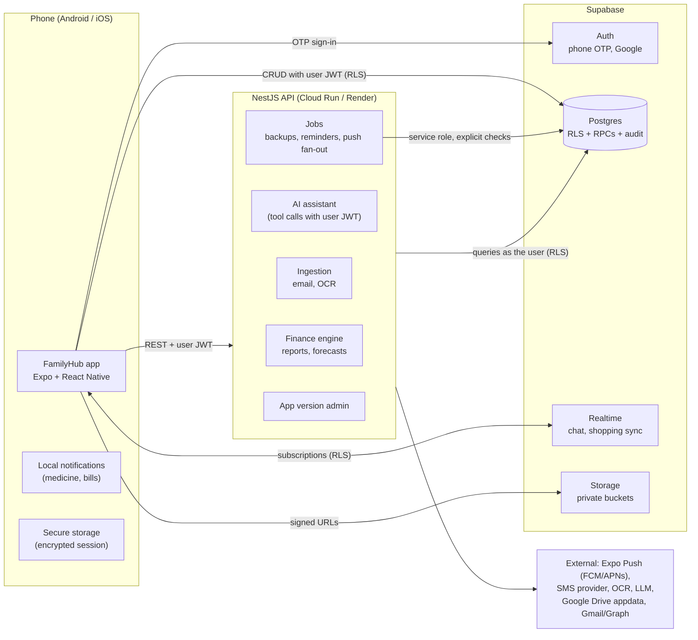

# FamilyHub: Architecture, Data Model and Delivery Plan

Status: **v1.0, approved for Phase 1**. Last updated 1 Nov 2026.
Owner: Jeet Yadav. Source spec: `docs/SPEC.md` (the FamilyHub Master Development Prompt).

This document is the single architectural reference for FamilyHub. Every phase builds on it. Change it deliberately (with a dated note in §15), never silently.

---

## 1. Decisions at a glance

| Area | Decision | Why |
|---|---|---|
| Mobile | **React Native 0.88 + Expo SDK 58 + TypeScript + Expo Router** | One codebase for Android and iOS, file-based navigation, EAS for builds and store submission. |
| Backend | **Supabase + NestJS 12 (ESM, Vitest)** | Supabase provides phone-OTP auth, Postgres with Row Level Security, storage and realtime. NestJS hosts logic that needs secrets or heavy computation: finance engine, AI, email ingestion, OCR, backups, push fan-out. |
| Database | **PostgreSQL (Supabase)**, SQL migrations in `supabase/migrations` | Relational integrity for money; RLS enforces family and personal isolation inside the database itself. |
| Authorization | **RLS on every table + `SECURITY DEFINER` RPCs for multi-step operations + NestJS guards that re-check in the database** | The database is the final authority, so no client or API bug can leak another family's data. |
| Repo | **npm workspaces monorepo** (`apps/mobile`, `apps/api`, `packages/shared`, `supabase`) | Shared types, validation and business rules in one place. |
| Launch | **Family first** (private builds), store release later | Avoids SMS DLT registration, Gmail CASA audit and store review until the product is proven. |
| OTP during family testing | **Supabase test phone numbers** with fixed OTPs | No SMS cost, no DLT needed. Real SMS provider added before wider rollout. |
| Push | **Expo Push Service** (delivers via FCM on Android and APNs on iOS) + **local notifications** for time-critical reminders | Meets the FCM/APNs requirement with one integration. |
| Money | `numeric(14,2)` in INR by default, never floating point; one SQL definition of "counts as spend" reused by budgets, reports and AI | Prevents double counting and drift between screens. |

---

## 2. Feasibility, platform restrictions and dependencies

These shape the design. Each one is handled honestly in the product rather than faked.

### 2.1 Automatic transaction detection
- **iOS** gives no app access to the SMS inbox. iOS detection = share-to-app (share extension), forwarded emails, receipt OCR and manual entry.
- **Android SMS** (`READ_SMS`/`RECEIVE_SMS`) is a restricted Google Play permission. "SMS-based money management" is a listed exception, but approval is a manual Play review and is temporary/revocable. Plan: build it as an **Android-only, opt-in, separately flagged** module (Phase 8) that is parsed **on-device**, with manual entry and email as the always-available paths. For family-only builds distributed outside Play (EAS internal distribution), the permission works without Play review.
- **Gmail**: every mailbox-reading scope (`gmail.readonly`, `gmail.metadata`, `gmail.modify`…) is a **restricted scope**. Server-side processing requires Google verification **plus an annual third-party CASA security assessment**. Family-first plan: use **forwarded emails** to a FamilyHub inbound address (no Google scopes at all) and keep Gmail OAuth behind a flag with the app in "Testing" mode (up to 100 test users, no verification) until a public launch justifies CASA.
- **Microsoft Graph** (`Mail.Read`): feasible; needs an Azure app registration and publisher verification for public use. Phase 8.

### 2.2 Authentication and SMS in India
- Supabase Auth supports phone OTP natively (Twilio, MessageBird, Vonage, Textlocal) and a **Send SMS Hook** that lets us use any Indian provider (e.g. MSG91) or WhatsApp.
- Commercial SMS in India requires **TRAI DLT registration** (entity, sender header, OTP template). This is a business onboarding task, not code. Until then, **test phone numbers** (fixed OTP per number, with an expiry date) let the family sign in with no SMS sent.
- Children without their own phone number cannot have independent logins (spec requires independent accounts). Decision needed later: parent-managed child profiles without login (see §14).

### 2.3 Google Drive backup
- Use only **`drive.appdata`** (hidden app folder). It is **non-sensitive**: basic verification only, no security assessment. Google Sign-In (login) and Drive backup (storage) are separate consents and separate code paths.

### 2.4 App updates
- Android: Google Play **In-App Updates API** (flexible and immediate) via an Expo-compatible module. Works only for Play-installed apps.
- iOS: no in-app install API; we show release notes and deep-link to the App Store listing.
- JS-only fixes can ship through **EAS Update** (over-the-air) within store policy; native changes always go through the stores. No APK sideloading, ever.

### 2.5 Privacy and compliance (India)
- The **DPDP Rules 2025** were notified on 13 Nov 2025 with phased commencement; core obligations become enforceable on **13 May 2027**. Public launch must ship: privacy notice at collection, consent records, data export, account deletion, grievance contact, breach process. Phase 1 already provides family-level isolation, audit logs and revocable membership; the remaining items are planned in Phases 5 and 8 and are a hard gate for public launch.
- **Aadhaar**: never store the full number. The vault stores the user's own document image and, at most, the last 4 digits.
- **Health data**: private to its owner by default; never sent to AI services with identifiers; AI never diagnoses or changes dosages.

---

## 3. System architecture



### 3.1 Who does what

| Concern | Where it lives | Rule |
|---|---|---|
| Simple CRUD on owned/shared records | App → Supabase (PostgREST) | RLS decides visibility and writes. |
| Multi-row or privileged operations (create family, accept invite, change role, restore) | Postgres `SECURITY DEFINER` RPCs | Each RPC checks membership/permission itself, writes audit rows, runs in one transaction. |
| Calculations that must be identical everywhere (spend, budgets, forecasts) | SQL views/functions + NestJS finance engine | One definition, reused by screens, reports and the AI assistant. |
| Anything needing a secret (LLM key, OCR key, OAuth refresh tokens, SMS provider) | NestJS | Secrets never ship in the app bundle. |
| Background work (backups, reminders, recurring bills, push) | NestJS jobs (`@nestjs/schedule`), later a queue | Service-role access only inside jobs, with explicit family checks. |

**NestJS never uses the service role for user requests.** It verifies the Supabase JWT, then talks to Postgres *as the user* (anon key + the user's bearer token), so RLS applies to API calls exactly as it does to the app.

### 3.2 Repository layout

```
familyhub/
├─ apps/
│  ├─ mobile/            Expo app (Expo Router, TypeScript); routes in src/app
│  └─ api/               NestJS API
├─ packages/
│  └─ shared/            Roles, permission catalog, zod schemas, phone & invite-code utils,
│                        dashboard widget registry, (Phase 2+) finance rules
├─ supabase/
│  ├─ config.toml        Supabase CLI config (local test OTP numbers)
│  ├─ migrations/        Ordered SQL migrations: schema, RLS, RPCs, triggers
│  ├─ seed.sql           Reference data only (never fake transactions)
│  └─ tests/             Database tests (RLS, RPCs, invariants) against real Postgres
├─ docs/                 SPEC, ARCHITECTURE, PROGRESS, phase reports
└─ CLAUDE.md             Working rules for anyone (human or AI) changing this repo
```

---

## 4. Authentication and authorization

### 4.1 Sign-in
1. User enters a mobile number (country code default **+91**), normalised to E.164.
2. `supabase.auth.signInWithOtp({ phone })` → 6-digit OTP (SMS, or fixed code for test numbers).
3. `verifyOtp({ phone, token, type: 'sms' })` → session. New users get a `profiles` row via trigger and complete a short profile step (name).
4. Session is stored **encrypted**: a random AES-256 key lives in the OS keystore (`expo-secure-store`), the encrypted session lives in AsyncStorage (keystore items are size-limited).
5. Rate limiting: Supabase OTP frequency and hourly limits (configured in project settings), plus CAPTCHA before public launch.
6. **Google Sign-In** (Phase 8, optional): `linkIdentity` on an existing phone account, so it never creates a duplicate account.

### 4.2 Accounts, families and roles
- One **account** per person (keyed by verified phone). A person can belong to **many families** and switches between them; the last-used family is remembered per account.
- Roles per family membership: **admin, adult, viewer**. A **child** role exists in the schema but is **hidden** (owner decision, 1 Nov 2026: FamilyHub has no child users). No invitation or membership can use it; re-enabling it is a one-line change to `app.role_is_assignable()` plus `ASSIGNABLE_ROLES` in `packages/shared`.
- **Primary admin** = `families.primary_admin_id` (exactly one). Any other member with role `admin` is a **secondary admin** with full admin powers *except* deleting the family and transferring primary ownership. The primary admin cannot be demoted or removed until ownership is transferred (enforced by RPC and by a trigger).
- Removing a member sets their membership to `removed`; their account, personal data and other families are untouched. Access stops immediately because every RLS check requires an `active` membership.

### 4.3 Permission model
- A **permission catalog** (`permissions`) lists keys such as `members.invite`, `audit.view`, `finance.edit_shared`. Each key has a module, the phase it becomes live, and an `admin_only` flag.
- **Defaults** (`role_permissions`) give each role its baseline. Admins implicitly hold every permission.
- **Per-family overrides** (`family_role_permissions`) let a family's admins grant or revoke non-admin-only permissions for adult/child/viewer.
- One function answers every check: `app.has_permission(family_id, permission)`. RLS policies, RPCs and NestJS guards all call it.

| Permission (Phase 1 live) | Admin | Adult | Viewer | Grantable |
|---|:-:|:-:|:-:|:-:|
| family.settings | ✓ | – | – | admin only |
| members.invite | ✓ | – | – | yes |
| members.change_role / members.remove / permissions.manage | ✓ | – | – | admin only |
| audit.view | ✓ | – | – | yes |

`records.delete_permanent` and `backup.restore_family` (admin only) are in the catalog and go live in Phase 5.

Later-phase permissions (finance, shopping, tasks, vault, health, chat, calendar) are already in the catalog with their phase number; their defaults follow spec §3 (adults edit shared records, viewers read only). Child defaults remain in the catalog but are unused while the role is hidden.

### 4.4 Personal or Family records (pattern for every module from Phase 2)
Owner decision (1 Nov 2026): every record offers exactly two choices, shown on every add/edit form.

Every record carries `family_id`, `owner_id` and `visibility` (`personal` | `family`, Postgres enum `record_visibility`, shared constant `RECORD_VISIBILITIES`):
- `personal` → only the owner can read or change it. Admins cannot see it either.
- `family` → readable by active members holding the module's view permission; editable by holders of its edit permission.

New records start as **personal**; sharing is always an explicit choice, and the owner can switch a record between the two at any time (audited). Exceptions where the record is shared by nature: shopping lists and family chat are always `family`. Family totals (dashboards, family budgets, the AI assistant) include only `family` records plus the viewer's own `personal` records, and say so on screen.

Records about someone who doesn't use the app (for example a child's vaccination card or school fees) are kept by the member who adds them, as Personal or Family like any other record. There are no separate child profiles.

### 4.5 Step-up confirmation for critical actions
Deleting a family and transferring primary admin require a **fresh OTP**: the RPC checks the JWT `amr` claim and rejects if the last OTP verification is older than 10 minutes. The app shows an in-place "confirm with OTP" sheet, then retries. Other admin actions (role change, removal) require an explicit confirmation dialog and are audited with an optional reason.

---

## 5. Data model

### 5.1 Conventions
- `uuid` primary keys (`gen_random_uuid()`), `created_at` / `updated_at` (`timestamptz`, trigger-maintained), `deleted_at` for soft delete where records can be restored.
- Money is `numeric(14,2)` with a `currency` column (default `INR`). Never `float`.
- Enums are Postgres enums or check constraints; every foreign key is indexed.
- Internal helpers live in schema **`app`**, which is not exposed through the REST API.
- Every table has RLS enabled; `anon` has no table access at all.
- Audit: an `AFTER INSERT/UPDATE/DELETE` trigger writes `audit_logs` with actor, old/new values (secrets stripped) and an optional reason supplied by the calling RPC.

### 5.2 Phase 1 tables (implemented)

| Table | Purpose | Key columns |
|---|---|---|
| `profiles` | One per account (mirrors `auth.users`) | id = auth user id, phone (E.164, from auth, read-only), display_name, avatar_path, timezone, locale, last_family_id |
| `families` | Family workspace | name, primary_admin_id, currency, timezone, created_by, deleted_at |
| `family_members` | Membership + role | family_id, user_id, role, status (`active`/`removed`/`left`), relationship_label, invited_by, joined_at, removed_by, removed_at; unique (family_id, user_id) |
| `family_invitations` | Invite by phone, link, QR or code | family_id, invited_by, phone (optional lock), role, relationship_label, code_hash (SHA-256, never readable by clients), code_hint (last 2 chars), status, expires_at (7 days), accepted_by |
| `invitation_attempts` | Brute-force protection for invite codes | user_id, success, created_at |
| `permissions` | Permission catalog | key, module, description, admin_only, available_from_phase |
| `role_permissions` | Default role → permission matrix | role, permission |
| `family_role_permissions` | Per-family overrides | family_id, role, permission, allowed |
| `family_activity` | Human-readable activity feed for the home screen | family_id, actor_id, verb, entity_type, entity_id, data |
| `audit_logs` | Immutable audit trail | family_id, actor_id, action, table_name, record_id, old_values, new_values, reason |
| `user_dashboard_layouts` | Per-user, per-family widget order and visibility | user_id, family_id, widgets (jsonb) |

### 5.3 Entity map for all phases

Grouped by domain; each table follows §5.1 and the §4.4 visibility pattern.

- **Identity & family** (P1): profiles, families, family_members, family_invitations, permissions, role_permissions, family_role_permissions, audit_logs, family_activity, user_dashboard_layouts. Later: user_consents (P5), devices / push_tokens (P4), sessions are managed by Supabase Auth.
- **Finance** (P2): payment_sources (bank account / debit card / credit card / UPI / wallet / cash / BNPL / gift card; masked numbers only), merchants, categories (expense & income, hierarchical, custom icon/colour), transactions, transaction_splits (category allocations), transaction_links (refund ↔ original, duplicate ↔ original), transaction_review_logs, import_events (SMS/email/OCR raw metadata, never OTPs).
- **Planning** (P3): budgets, budget_lines (category / member allocations), budget_alert_rules, budget_alert_events, credit_card_statements, loans, emi_schedule, savings_goals, savings_contributions, forecast_snapshots (always labelled as estimates).
- **Shopping & collaboration** (P4): shopping_lists, shopping_items, shopping_purchases, expense_shares, settlements, chat_conversations, chat_participants, chat_messages, message_attachments, message_reactions, message_reads.
- **Vault & resilience** (P5): folders, documents, document_shares, attachments (generic, used by every module), emergency_access_grants, backup_jobs, backup_records, restore_jobs, restore_history, recycle_bin view over soft-deleted rows.
- **Health & household** (P6): health_profiles, medicines, medicine_schedules, medicine_doses (scheduled vs actual, taken/skipped/missed), medicine_stock, medical_records, appointments, vaccinations, tasks, task_events, reminders, calendar_events, event_attendees, bills, bill_payments, subscriptions.
- **More modules** (P7): recipes, recipe_ingredients, meal_plans, inventory_items, inventory_movements, vehicles, vehicle_services, properties, tenancies, trips, trip_members, trip_items.
- **Intelligence & ops** (P8): email_connections (encrypted tokens), ai_conversations, ai_tool_calls (audit of what data the assistant read), app_versions, release_notes, rollout_controls, notification_preferences, notification_queue (dedupe key per user/type/entity/time).

### 5.4 Finance accounting model (designed now, built in Phase 2)
One `transactions` table with a **kind** and a **status**:

- `kind`: `expense`, `income`, `transfer` (own accounts), `card_payment` (credit card bill settlement), `refund`, `loan_disbursal`, `emi_payment`, `settlement` (family member pays back another).
- `status`: `active`, `pending_review`, `excluded_not_expense`, `excluded_not_income`, `duplicate`, `archived`, `corrected`.

One SQL view, **`v_effective_spend`**, is the only definition of spend:
- counts `kind = expense` with status `active`, `corrected` or `archived`;
- subtracts linked `refund`s from the original expense (refunds without a link count as income-side `refund`, never negative spend in another month unless linked);
- never counts `transfer`, `card_payment`, `settlement`, `loan_disbursal`, or anything `excluded_*`, `duplicate` or `pending_review`;
- **EMI**: each loan has an `accounting_basis`. `purchase` (default for card EMIs): the purchase is spend once, on its date; EMI payments are settlements, and only interest and fees are added as spend. `repayment` (home and vehicle loans): the asset purchase is not spend; each EMI counts as `EMI & Loans` spend.
- splits must sum exactly to the parent amount (deferred constraint trigger).

Budgets, reports, the dashboard and the AI assistant all read this view, so a rule fix in one place fixes every screen.

---

## 6. API structure

### 6.1 Supabase (direct, RLS enforced)
Table reads/writes allowed by policy, e.g. `profiles` (own), `families` (members read; `family.settings` updates), `family_members` (members read), `family_activity` (members read), `user_dashboard_layouts` (own).

### 6.2 RPCs (Phase 1)

| RPC | Who | What |
|---|---|---|
| `create_family(name, relationship_label?)` | any signed-in user | Creates family, makes caller primary admin, logs activity. |
| `create_invitation(family_id, role, phone?, relationship_label?)` | `members.invite` (admin role invites need admin) | Returns a one-time human code (e.g. `K7QM-4XPA`) shown once; stores only its hash. |
| `reissue_invitation(invitation_id)` | `members.invite` | New code, new 7-day expiry, old code dead. |
| `revoke_invitation(invitation_id)` | `members.invite` | Revokes a pending invite. |
| `preview_invitation(code)` | any signed-in user | Family name, inviter, role, expiry, so the user knows what they are joining. Rate-limited. |
| `accept_invitation(code)` | any signed-in user | Joins (or re-joins) the family. Phone-locked invites only work for that phone. 10 failed attempts per hour per user. |
| `my_pending_invitations()` / `accept_invitation_by_id(id)` | invitee | Invites addressed to the caller's verified phone; one-tap join, no code needed. |
| `change_member_role(family_id, user_id, role, reason?)` | admin | Cannot touch the primary admin; only the primary admin can demote another admin. |
| `remove_member(family_id, user_id, reason?)` | admin | Membership → `removed`. Account kept. |
| `leave_family(family_id)` | member | Primary admin must transfer first. |
| `transfer_primary_admin(family_id, user_id)` | primary admin + fresh OTP | New primary becomes admin; old primary stays admin. |
| `delete_family(family_id, confirm_name)` | primary admin + fresh OTP | Soft delete (restorable by support within retention). |
| `set_role_permission(family_id, role, permission, allowed)` | `permissions.manage` | Overrides for adult/child/viewer only; admin-only keys refused. |
| `my_permissions(family_id)` | member | Effective permission keys for the caller. |
| `get_home_summary(family_id)` | member | Member count, pending invites, latest activity, setup checklist. |

### 6.3 NestJS REST (versioned `/v1`)

| Phase | Endpoints |
|---|---|
| P1 | `GET /health`, `GET /health/ready`, `GET /v1/me`, `GET /v1/families/:familyId/access` (demonstrates `@RequirePermission`) |
| P2 | `/v1/finance/summary`, `/v1/finance/reports/*`, `/v1/imports/receipt` (OCR stub until a provider key exists) |
| P3 | `/v1/budgets/:id/forecast`, `/v1/budgets/:id/what-if`, `/v1/loans/:id/schedule` |
| P4 | `/v1/push/register`, `/v1/notifications/*` |
| P5 | `/v1/backups`, `/v1/backups/:id/preview`, `/v1/restores`, `/v1/vault/ocr` |
| P6 | `/v1/health/adherence`, `/v1/reminders/sync` |
| P8 | `/v1/assistant/chat`, `/v1/integrations/gmail/*`, `/v1/app-versions/check`, `/v1/admin/app-versions` |

All endpoints: JWT verification (Supabase JWKS, HS256 fallback for local), request validation with shared zod schemas, rate limiting, structured errors `{ error: { code, message } }`, OpenAPI docs at `/docs`.

---

## 7. Navigation and UI/UX structure

### 7.1 Route map (Expo Router)

```
/             entry route: redirects to sign-in, profile-setup, family-setup or /home
(auth)        sign-in (phone) → verify (OTP)
profile-setup → family-setup (accept invite | create | join)
join, scan    code entry and QR scanner (also reachable from inside the app and via deep link)
(app)/(tabs)  /home · /finance · /shopping · /health · /family · /more
(app)         family/switch, family/invite, family/invitations, family/member/[id],
              family/permissions, family/audit, family/settings,
              customize-dashboard, settings, activity, module/[key], deep link familyhub://join?code=…
```

- **Home**: greeting and family switcher, then the user's chosen widgets (§7.2), then Quick Add.
- **Finance / Shopping / Health** tabs: real module screens from their phase; until then an explicit "arrives in Phase N" screen with no fake controls.
- **Family**: members with roles, invite, pending invitations, permissions, audit log, family settings.
- **More**: every module in spec §4 order; live modules open, upcoming ones show their phase.
- **Quick Add (FAB)**: only lists actions whose module is live (Phase 1: Invite member). Each phase adds its actions.

### 7.2 Dashboard widgets
A shared widget registry defines each widget's id, title, module and phase. The home screen renders only live widgets in the user's saved order; the customise screen lets users reorder and hide them and lists upcoming widgets as "coming in Phase N". Widgets never show placeholder numbers: a module with no data shows a proper empty state.

Phase 1 widgets: Family members, Pending invitations (inviters only), Family activity, Setup checklist (invite someone, add a second admin, set family name/currency).

### 7.3 Design system
Tokens for colour (light and dark), spacing (4-pt grid), radius, typography (system fonts, Dynamic Type respected), elevation. Components: Screen, AppText, Button, IconButton, TextField, PhoneField, OtpField, Card, ListItem, Avatar, Badge, Chip, SegmentedControl, EmptyState, ErrorState, LoadingState, ConfirmDialog, Sheet, Fab, Toast. Every data screen has loading, empty, offline and error states. Minimum touch target 44 pt.

---

## 8. Cross-cutting services

- **Realtime**: Postgres changes (RLS-filtered) for shopping lists, tasks and chat; Broadcast for typing indicators and presence.
- **Storage**: private buckets, object path `{family_id}/{module}/{record_id}/{uuid}`; storage policies mirror table RLS; downloads via short-lived signed URLs; images compressed on device (receipt-safe quality); sensitive vault items gated by device biometrics.
- **Notifications**: `notification_preferences` per user and category; server queue with a dedupe key; Expo Push for server events; on-device scheduled notifications for medicine and bill reminders (re-synced on app start and after changes).
- **Offline**: React Query cache persisted on device; writes require connectivity in Phases 1–3 with clear offline messaging; queued offline writes for shopping and tasks in Phase 4.
- **Backup & restore** (Phase 5): Supabase daily backups protect the platform. Family-level backups are versioned, encrypted archives (JSON per table + attachment manifest) in a private bucket; optional copy to Google Drive `appdata`, encrypted with a key derived from the user's backup passphrase so Google cannot read it. Restore = import into a staging schema → preview (counts, conflicts) → automatic recovery snapshot → non-destructive merge that never overwrites newer rows → `restore_history`.
- **AI assistant** (Phase 8): the model can only call a fixed set of server-side tools (e.g. `spend_summary(range, filters)`), each executed with the user's JWT so RLS limits what it sees. No model-generated SQL. Identifiers and document numbers are redacted before any external call. Every write it proposes needs explicit user confirmation.

---

## 9. Phase plan and acceptance criteria

Each phase ends with: features, screens, APIs, tables, tests, known limitations, run and test instructions (`docs/phases/PHASE-N.md`), and an updated `docs/PROGRESS.md`. A phase is complete only when its tests pass and its core flows were exercised on a real build.

| Phase | Scope | Acceptance criteria |
|---|---|---|
| **1. Foundation** | Monorepo, auth (OTP), profiles, families, invitations (code, link, QR, SMS composer, phone-addressed), roles and permission overrides, audit and activity, home dashboard with customisable widgets, 6-tab navigation, theming, NestJS foundation | Two accounts on two phones: A creates a family, invites B by phone; B signs in and joins with one tap; roles enforced (viewer cannot invite; removed member loses access instantly); DB tests prove cross-family isolation; API rejects bad/expired tokens. |
| **2. Core finance** | Payment sources, categories, merchants, manual expenses and income, payment-source picker workflow, correction / exclusion / duplicate / archive, splits, refunds and transfers, finance reports | Accounting test suite (§5.4) passes; dashboard totals equal report totals equal SQL view; excluded rows never counted; archived valid rows still counted. |
| **3. Planning** | Budgets (family, member, category, custom period), forecasts with confidence and basis, alerts 50/75/90/100 %, daily spend guidance, credit card dashboard, EMI and loans, savings goals | Forecasts labelled as estimates; budgets never auto-changed; EMI schedule maths verified against a reference amortisation table. |
| **4. Shopping & collaboration** | Shared lists with realtime sync, photos, purchase → confirmed expense, recurring lists, expense splitting and settlements, family chat, push notifications | Two devices see list changes within 2 s; settlement creates no duplicate spend; chat → task/expense only after confirmation. |
| **5. Vault & resilience** | Family Vault, folders, sharing, expiry reminders, OCR suggestions (confirm before save), archive and recycle bin, audit history UI, backup and restore, consent records, data export | Restore preview matches backup counts; restore never overwrites newer rows; recovery snapshot exists before every restore. |
| **6. Health & household** | Health profiles, medicines, schedules, local reminders, adherence, stock and refill, records, appointments, tasks, calendar, bills and subscriptions | Doses never auto-marked taken; reminders fire with the app closed and offline; bills never auto-marked paid. |
| **7. More modules** | Meals and recipes, inventory, vehicles, property, travel, advanced savings | Ingredients → shopping items; no stock change without a confirmed action. |
| **8. Intelligence & production** | AI assistant, receipt OCR, email ingestion, Android SMS (opt-in), Google Sign-In, Drive backup, app update management, security testing, performance, store release | Assistant answers only from authorised rows (tested with a cross-member leak suite); Play in-app update tested via internal app sharing; DPDP launch checklist complete. |

---

## 10. External services, accounts and costs

| Service | Needed for | When | Cost (indicative, verify before buying) |
|---|---|---|---|
| Supabase | DB, auth, storage, realtime | Phase 1 | Free tier for testing (projects pause after 7 idle days); **Pro US$25/month** for production, includes 100k MAU, 8 GB DB, $10 compute credit |
| GitHub | Source control, CI | Phase 1 | Free (private repo) |
| Expo / EAS | Builds, internal distribution, OTA updates, push | Phase 1 | Free tier available; paid plans for more builds |
| Apple Developer Program | Any iOS install beyond dev builds (TestFlight), App Store | Before iOS family testing | US$99/year |
| Google Play Console | Play internal testing and release | Before Play release (Android APKs via EAS work without it) | US$25 one-time |
| NestJS hosting | API | Phase 2 onward | Low cost: Google Cloud Run (free tier) or Render/Railway small instance |
| SMS OTP provider + TRAI DLT | Real OTP SMS in India | Before inviting beyond test numbers | Per-SMS charges plus one-time DLT registration; family testing uses free test numbers |
| OCR (Google Cloud Vision or similar) | Receipts, documents | Phase 5/8 | Usage-based, free monthly allowance |
| LLM API | AI assistant | Phase 8 | Usage-based per token |
| Google Cloud project | Google Sign-In, Drive appdata, Gmail | Phase 8 | Free; Gmail restricted scope needs verification + annual CASA assessment for public use |
| Microsoft Entra app | Outlook ingestion | Phase 8 | Free; publisher verification for public use |

**Environment variables / keys** (never committed; `.env.example` files list them): `SUPABASE_URL`, `SUPABASE_ANON_KEY` (public), `SUPABASE_SERVICE_ROLE_KEY` (API jobs only), `SUPABASE_JWT_SECRET` (local HS256 only), `EXPO_PUBLIC_API_URL`, later `LLM_API_KEY`, `OCR_API_KEY`, `GOOGLE_OAUTH_*`, `SMS_HOOK_SECRET`.

---

## 11. Deployment

- **Database**: `supabase db push` applies migrations to the hosted project; migrations are forward-only and tested in CI against a fresh Postgres.
- **API**: Docker image → Cloud Run (or Render). Health check `/health/ready`. Zero secrets in the image.
- **Mobile**: EAS Build profiles `development` (dev client), `preview` (internal APK / TestFlight for the family), `production` (stores). EAS Update channels per profile.
- **CI** (GitHub Actions): typecheck, lint, unit tests, API tests, DB tests on a Postgres service container, mobile web-export smoke build.
- **Environments**: `local` → `staging` (Supabase free project) → `production` (Supabase Pro).

### Infrastructure sizing
A family of 4–10 people generates well under 1 GB of relational data per year; attachments dominate. Supabase Free covers family testing; Pro with Micro compute covers thousands of families. Scale levers in order: indexes and query plans, compute size, read replicas, moving heavy reports to materialised views.

---

## 12. Testing strategy

| Layer | Tooling | What |
|---|---|---|
| Database | Vitest + `pg` against real Postgres 16 with Supabase auth stubs | RLS isolation (cross-family, private records, removed members), RPC rules, invariants (primary admin protection, invite brute force), audit rows written, secrets never readable |
| Shared | Vitest | Phone normalisation, invite-code format, permission matrix, (P2+) accounting rules |
| API | Vitest + Supertest | JWT guard (valid, expired, wrong audience, wrong signature), permission guard, error format |
| Mobile | jest-expo + React Native Testing Library 14, `tsc --noEmit`, web export smoke build | Form validation, components, session encryption, sign-in flow |
| End-to-end | Maestro flows on device builds (from Phase 2) | Sign-in, create family, invite, join |

---

## 13. Security checklist (applies to every phase)
- RLS enabled on every table; `anon` has no table privileges; policies covered by tests.
- `SECURITY DEFINER` functions set `search_path = ''` and fully qualify every object.
- Secrets hashed (invite codes) or excluded from client column grants; audit rows strip them.
- Never store card numbers, CVV, PIN, OTP, passwords or banking credentials. Payment sources store masked last-4 only.
- Service role key exists only in the API job runner, never in the app.
- Critical admin actions need fresh OTP and leave an audit trail.
- Minimum device permissions, requested only at the moment of use, with a reason.

---

## 14. Open decisions (need the owner's input before the named phase)

1. ~~Children without phones~~ **Decided 1 Nov 2026:** no child users or child profiles; Child role hidden; records about children are kept by a parent as Personal or Family (§4.2, §4.4).
2. **Hosting region** (before production): Supabase Mumbai region (`ap-south-1`) for latency and data residency, recommended.
3. **SMS provider** (before wider rollout): MSG91 via Send SMS Hook, or Twilio Verify.
4. **Family Admin recovery** (Phase 5): if the primary admin's number is lost, allow a secondary admin to claim primary after a waiting period with notifications?

---

## 15. Change log
- 2026-11-01: Owner decisions: no child users (Child role hidden, enforced in the database); records are Personal or Family only, default Personal (§4.2, §4.4, §14).
- 2026-11-01: v1.0 created with Phase 1 implementation. Versions pinned at build time: Expo SDK 58 / React Native 0.88, NestJS 12 (ESM, so the API uses Vitest instead of Jest). Home moved to `/home` with an explicit `/` entry redirect so the signed-out start screen is deterministic on every platform.
